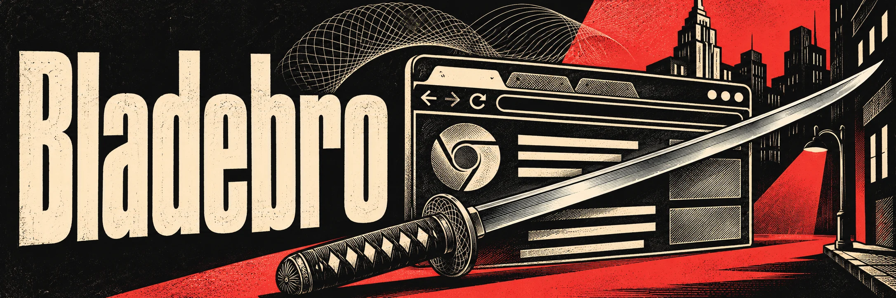
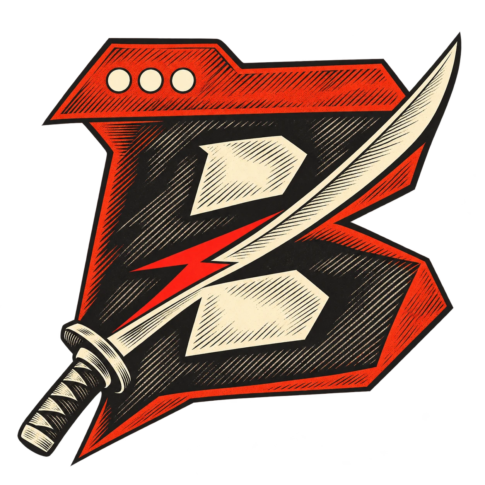
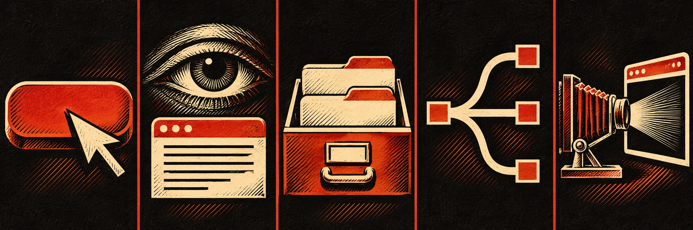
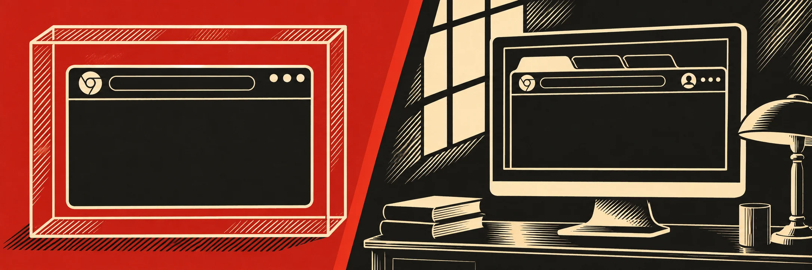

<p align="center">
  
</p>

<h1 align="center">ladebro</h1>

<p align="center"><strong>Drive a real browser from your agent or terminal.</strong><br>
Click, fill forms, read pages, and keep a browser session across calls. Five MCP tools in one Rust binary.</p>

<p align="center">
  <a href="https://www.npmjs.com/package/bladebro"></a>
  <a href="https://github.com/dondai44423/bladebro/stargazers"></a>
  <a href="LICENSE"></a>
</p>

<p align="center">
  <a href="#quickstart">Quickstart</a> ·
  <a href="#the-five-tools">Tools</a> ·
  <a href="#browser-modes">Browser modes</a> ·
  <a href="#how-it-works">Architecture</a> ·
  <a href="#docs">Docs</a> ·
  <strong><a href="#sponsors">Sponsor</a></strong>
</p>

## Quickstart

Install Chrome or Chromium on the machine running Bladebro. Then open and read a page from the terminal.

```sh
npm install -g bladebro
bladebro nav https://example.com
bladebro see content
bladebro stop
```

The first browser command starts a local daemon. Later calls use the same tabs and page state until you stop it. Run `bladebro doctor` if Chrome or its display cannot start. Linux, macOS, and Windows are available as [prebuilt binaries](docs/setup.md#prebuilt-binaries).

### Connect an agent

Add this stdio server to your MCP client. Restart the client or start a new session after saving.

```json
{
  "mcpServers": {
    "bladebro": {
      "command": "bladebro",
      "args": ["mcp"]
    }
  }
}
```

The schema comes from the binary. In the shell, `bladebro help --json` includes the same tool definitions plus CLI usage and exit codes. [Pi, DeepSeek Harness, and Hermes setup](docs/setup.md#agent-integrations).

### From source

For a source or portable install, see [the build instructions](docs/setup.md#from-source) or [download a prebuilt binary](docs/setup.md#prebuilt-binaries).

## The five tools

<p align="center">
  
</p>

| Tool | Use it to |
|---|---|
| [`act`](docs/tools.md#act) | Navigate, click, type, fill, scroll, read a control, or handle files. Input returns a verdict and page changes. |
| [`see`](docs/tools.md#see) | Inspect interactive elements, read Markdown or headings, find text, or extract structured records. |
| [`state`](docs/tools.md#state) | Manage tabs, cookies, storage, saved sessions, and resource blocking. |
| [`run`](docs/tools.md#run) | Execute a plan with reads, actions, branches, and bounded loops in one call. |
| [`vision`](docs/tools.md#vision) | Capture a PNG, optionally marked with element references. |

A typical loop is `see` → `act` → inspect the result. Use a reference like `e5`, a selector, a label, or visible text. If several controls match equally well, Bladebro returns the candidates so the caller can choose. Use the page model for ordinary reading and `vision` when layout matters.

```sh
bladebro nav https://example.com
bladebro see model
bladebro see outline
bladebro see extract links --json
bladebro vision --marks
bladebro stop
```

[Action examples, plans, and result formats](docs/tools.md)

## Browser modes

<p align="center">
  
</p>

| Mode | Profile and ownership |
|---|---|
| **Agent browser** · default | Bladebro launches and owns Chromium with a dedicated profile. This suits a separate browsing workspace. |
| **Your browser** · `bladebro rb on` | Use an installed Chromium-family browser and selected profile. Auto mode attaches to an available debug endpoint or imports a copy. The driver keeps its page model and actions while page injection is off. |

Start with the agent browser for a clean workspace. Use real-browser mode when a task depends on your browser setup or authenticated state. Actions in a signed-in profile can affect your account.

`bladebro rb status` shows which browser and profile are selected. `bladebro rb pause` hands input back to you, and `bladebro rb off` switches back to the agent browser. [Profiles, attachment, and ownership](docs/browser-modes.md).

## How it works

**Agent or CLI → Bladebro → Chromium DevTools Protocol → live browser.**

- **A model that stays with the page.** Bladebro builds a structural view from the live DOM. References can survive re-renders when the element still matches. Get fresh references after navigation or a tab switch.
- **Small responses during interaction.** Actions normally return a verdict and the delta. Use `see content` for Markdown, `see outline` for headings, or `see extract` for records. Large reads expose a file and paging information.
- **Action outcomes carry evidence.** A click or submit dispatches once. After a disconnect, an unknown mutation outcome asks you to inspect the destination before retrying.
- **One local driver.** MCP and CLI share the same handlers. Chromium supplies the live browser, and the Rust binary handles transport, input, perception, and session state.

[Architecture and source map](docs/architecture.md) · [Platform and browser verification](SUPPORT-MATRIX.md) · [Recorded benchmark and methodology](STEALTH_BENCH.md)

## Docs

| Guide | Go here for |
|---|---|
| [Setup](docs/setup.md) | Prebuilts, source builds, MCP, Pi, DeepSeek Harness, Hermes, and updates |
| [Tools](docs/tools.md) | Syntax, addressing, tab and file operations, plans, and JSON output |
| [Browser modes](docs/browser-modes.md) | Separate profiles, cloning, attaching, and using your own browser |
| [Configuration](docs/configuration.md) | Browser discovery, storage, proxy setup, Linux displays, and troubleshooting |
| [Architecture](docs/architecture.md) | Live Page Model, stable refs, recovery, and source layout |
| [Support matrix](SUPPORT-MATRIX.md) | What was tested and on which systems |
| [Changelog](CHANGELOG.md) | Released behavior and fixes |

### Limits

Bladebro drives Chromium-family browsers. Cross-origin iframe content, extensions, and session video recording are outside the supported tool surface. Use `vision` for screenshots. Interactive challenges can stop a task with a `blocked:` verdict. The platform packages cover five targets, with differing levels of live verification. [Support matrix](SUPPORT-MATRIX.md).

<a name="-sponsors"></a>

## Sponsors

<p align="center"></p>

Sponsorship funds maintenance, testing, and releases for Bladebro. Top-of-README placement is capped at 5 active slots so every sponsor stays visible.

| Option | Price | What's included |
|---|---:|---|
| **Sponsor** | **$89/month** | Linked banner and short tagline near the top of the README, plus listing here. Prepay any number of months to lock the current rate. |
| **Integration Partner** | **$399 upfront, then $89/month** | Everything in Sponsor for your first 3 months, plus a scoped native integration (e.g. setup bridge, provider preset, or site/service adapter) built, tested, and documented with you. |

### How native integrations work

1. **Free scope check first**: email what you want to integrate before paying anything. Integrations must genuinely help Bladebro users and fit its 5-tool design. If it's not a fit, you can still take a standard **$89/month** Sponsor slot.
2. **Active maintenance**: while your sponsorship is active, the integration is maintained and kept working across Bladebro releases.
3. **Fair lifecycle**: if sponsorship ends, working integrations stay in Bladebro. If an unsponsored integration later breaks due to upstream changes or becomes a maintenance burden, it may be deprecated or removed after a heads-up.

### How to sponsor

Email **bhandaribishesh879@gmail.com** with your product URL, banner (if you have one), and whether you want a Sponsor slot or an Integration Partner scope check. I'll confirm availability and share PayPal details. [Email about sponsorship](mailto:bhandaribishesh879@gmail.com).

One-time support is also welcome through Ko-fi.

[](https://ko-fi.com/G5Y624N5RE)

---

[Star Bladebro](https://github.com/dondai44423/bladebro) · [Report an issue](https://github.com/dondai44423/bladebro/issues) · [Contribute](CONTRIBUTING.md) · [Security](SECURITY.md) · [Apache 2.0](LICENSE)
